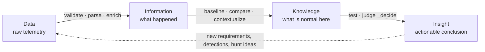

# DAIKI: From Data to Insight

**Fits at:** the foundation under every hunt. It decides where you enter (hunt type), what must be done to the data before it can support a conclusion, and what a finished hunt produces.
**Companion:** [Data Analysis for Threat Hunting](../Data_Analysis/Data_Analysis_Threat_Hunting.md) is the worked toolkit. This page is the model; that page is the practice.

---

## The idea

The threat intelligence process takes raw collection, processes it, analyzes it, and produces intelligence a decision-maker can act on. Nobody confuses a pile of raw reporting with intelligence.

Threat hunting is the same transformation applied to your own telemetry. Logs are not findings. A hunt is the disciplined work of drawing **security insight** out of **data**.

**DAIKI** names the chain: **Data → Information → Knowledge → Insight.** It descends from the data-information-knowledge-wisdom hierarchy (Ackoff, 1989), narrowed to what a hunter needs: the final stage is not wisdom, it is an insight you can act on.

The dotted line matters. Insight is not the end: it generates new collection requirements, new detections, and the next hunt's trigger.

---

## The four stages

| Stage | What it is | The question it answers |
|---|---|---|
| **Data** | Raw, unprocessed telemetry. No meaning yet. | Do we have it, and is it trustworthy? |
| **Information** | Data that is validated, structured, and labeled. | What happened? |
| **Knowledge** | Information placed in context of your environment. | What is normal here, and what does this relate to? |
| **Insight** | A judgment that supports a decision. | Is this a threat, and what do we do about it? |

Each arrow is a different kind of work, and each can fail independently.

---

## Worked through the RDP example

The [Data Analysis](../Data_Analysis/Data_Analysis_Threat_Hunting.md) write-up hunts RDP lateral movement (ATT&CK [T1021.001](https://attack.mitre.org/techniques/T1021/001/)) using Windows [Event ID 4624](https://learn.microsoft.com/en-us/previous-versions/windows/it-pro/windows-10/security/threat-protection/auditing/event-4624) with Logon Type 10. Its sections fall along the chain:

| Stage | What the hunt does at this stage | Where it lives in the write-up |
|---|---|---|
| **Data** | Confirm the events exist, are complete, and are usable before trusting any result | Data Validation and Quality Assessment; Initial Data Exploration |
| **Information** | Isolate Logon Type 10, interpret what the field means, enrich events with account and host context | The Logon Type discussion; the Enrichment guidance |
| **Knowledge** | Establish what normal RDP looks like: which sources are sanctioned jump servers, what each entity usually does, what business hours look like | Stacking by Source IP; the jump server lookup (`jumpservers.csv`); business-hours clustering; entity-based baselines |
| **Insight** | Decide which remaining activity is a credible lateral movement lead, and what the detection or escalation should be | Construct and Execute phases; ML lessons learned |

> Section names are as they appear in the file. The stage assignment is an interpretation, so adjust any row that doesn't match how you think about it.

The point of the table: the jump server lookup is not a filter, it is **Knowledge**. Until it exists, "RDP from an unusual source" is not a statement you can make.

---

## DAIKI and PACE are different axes

The Data Analysis write-up runs on a **PACE** workflow (Plan, Analyze, Construct, Execute). The two don't compete.

- **PACE** says *what you are doing* at a given moment in the analysis.
- **DAIKI** says *what you are holding*, and how far up the chain it has been refined.

| PACE phase | Typical DAIKI movement |
|---|---|
| Plan | Name the insight you need, then work backward to the data and context required to support it |
| Analyze | Data → Information → Knowledge (validation, exploration, baselining, stacking) |
| Construct | Knowledge → Insight (detection logic, models, thresholds) |
| Execute | Apply it, deliver the Insight as a typed outcome, feed gaps back to Data |

A useful habit: at the end of Analyze, ask which stage you actually reached. If you cannot point to the Knowledge (the baseline, the known-good list), Construct is premature.

---

## Where hunts fail on the chain

| Stage | Typical failure | Symptom | In the process |
|---|---|---|---|
| Data | Source not collected, short retention | Query returns nothing, and you can't tell why | Step 4 feasibility → NO-GO |
| Information | Broken parsing, inconsistent fields | Looks clean, but a field is silently null | HUNT-042's `DC05` sourcetype → CONDITIONAL |
| Knowledge | No baseline, no context on normal | Everything looks anomalous, or nothing does | Step 0, Step 3, known-good lists |
| Insight | Conclusion outruns the evidence | "No findings" reported as "no threat" | Telemetry caveat + the [Validation Hook](../references/validation-hook.md) |

A clean hunt result is an Insight-stage claim, so it is only as sound as the three stages beneath it. That is why a CONDITIONAL caveat has to travel into the final report: it records which lower stage was weak.

---

## DAIKI and the hunt types

The hunt type is the stage you start at. Everything below your entry point is work someone else already did, or work you must do first.

| Hunt type | Entry point | What you inherit | What you must still do |
|---|---|---|---|
| **Exploratory (EDA)** | **Data** | Nothing | The whole chain: validate, parse, baseline, then form insight |
| **Hypothesis-Based (HBO)** | **Knowledge** | An informed model of the environment | Confirm the data supports it, then test |
| **Threat-Informed (TIO)** | **Insight** (someone else's) | Actionable CTI about adversary behavior | Translate it to *your* data; re-earn it as local knowledge |
| **Purple Operations (DPO)** | **Insight** (red team) | Known-executed behavior and expected artifacts | Prove the telemetry and logic observe it |

Two consequences:

1. **TIO enters at the top, which is the risky place.** CTI is an insight about someone else's environment. Until you've confirmed you have the data, validated it, and know your own normal, you are applying an unverified insight to an unexamined environment. Work the chain *down* before testing it.
2. **EDA is the only type that builds the foundation for the others.** Baselines and data dictionaries from exploratory work become the Knowledge that later HBO and TIO hunts enter on. A program that never runs EDA rebuilds that foundation inside every hunt, or skips it.

---

## DAIKI across the lifecycle

| Process step | Chain movement |
|---|---|
| Step 0: Environment Context | Establishes Knowledge about your data platform |
| Step 1: Trigger | Delivers a starting point at some stage (a log gap, a CTI insight, a red team result) |
| Step 3: Initial Assessment | Gathers Knowledge: context, owners, known-good |
| Step 4: Feasibility | Audits Data and Information: availability, quality, parsing |
| Execute: gather & clean | Data → Information |
| Execute: investigate & validate | Information → Knowledge → Insight |
| Outcomes | The Insight, typed: detection, incident, control issue, gap, report, new idea |
| Report & Iterate | Insight loops back as new Data requirements and new triggers |

---

## One-line rule

> **Don't claim a stage you haven't earned.** Every hunt conclusion should trace down the chain: the insight rests on knowledge, which rests on validated information, which rests on data you verified you actually have.

---

## References

- Ackoff, R. L., "From Data to Wisdom," *Journal of Applied Systems Analysis*, 16 (1989), 3-9
- [Data Analysis for Threat Hunting](../Data_Analysis/Data_Analysis_Threat_Hunting.md) (this repo)
- [PEAK Threat Hunting Framework](https://www.splunk.com/en_us/blog/security/peak-threat-hunting-framework.html), Splunk
- [TaHiTI](https://www.betaalvereniging.nl/wp-content/uploads/DEF-TaHiTI-Threat-Hunting-Methodology.pdf), Betaalvereniging Nederland
- [A Framework for Threat Hunting](https://www.threathunting.net/files/framework-for-threat-hunting-whitepaper.pdf), Sqrrl
